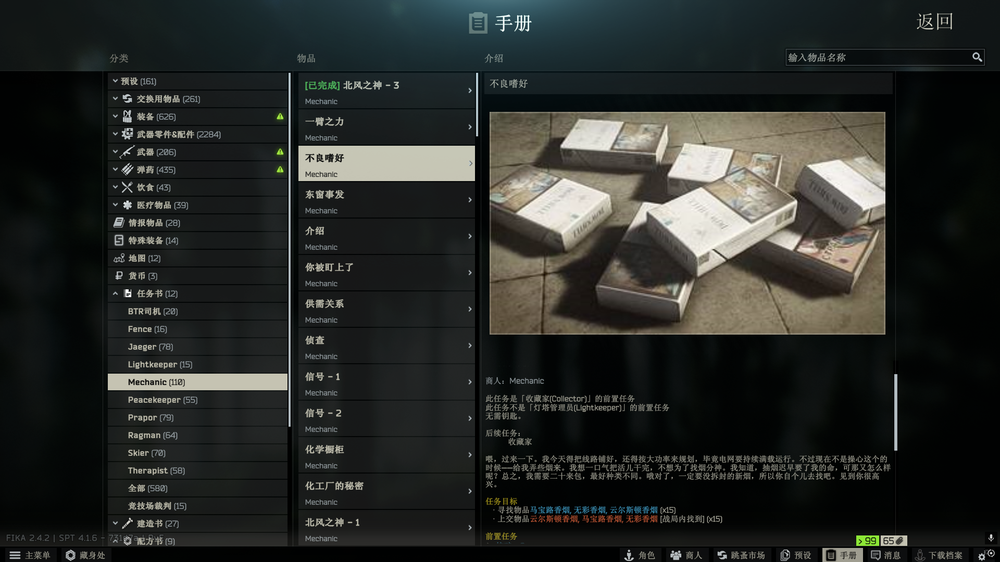
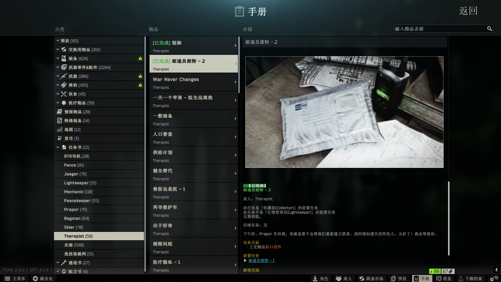
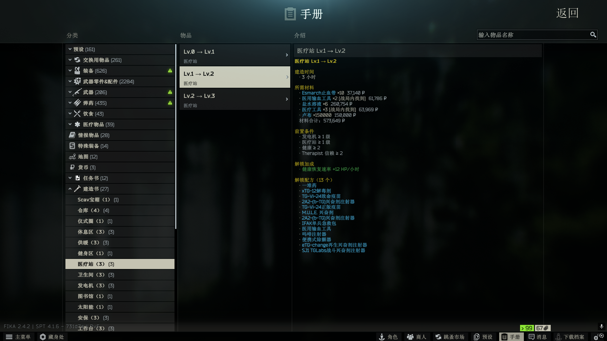

# QuestHandbook

拓展原版的游戏手册，提供便捷的查询和操作。

一个面向 **SPT 4.1.x** 的 Mod：在不修改任何游戏数据的前提下，向原生手册（Handbook）中注入三本虚拟工具书——**任务书、配方书、建造书**，让任务进度、藏身处配方与设施升级信息一站式可查。

## 功能特性

### 任务书

- 按商人分类列出全部任务，附「全部」汇总入口
- 任务详情完整呈现：目标（含「战局内找到」标记）、奖励、前置任务、解锁关系、角色等级与商人好感度要求
- 自动识别并标记已完成的任务（读取本地存档进度）
- 任务之间支持富文本跳转，前置 / 后续任务一键直达

### 配方书

- 按藏身处设施分类列出全部制造配方
- 材料、工具、资源与产物分区显示，图标复用原生手册样式
- 数据实时取自服务端，兼容改写配方数据的其他 Mod
- 根据材料价格自动计算配方成本

### 建造书（藏身处升级总览）

- 每个设施按等级列出升级所需的全部信息：
  - 建造材料（标注是否需要「战局内找到」，附跳蚤市场参考价）
  - 前置设施等级、技能等级、商人好感度要求
  - 建造时间
- 升级解锁的加成完整本地化显示
- 列出每级升级后解锁的制造配方，可直接跳转到配方书
- 数据在运行时从服务端藏身处表读取，兼容改写设施数据的其他 Mod

## 截图

## 安装

1. 下载发布页的 zip 并解压。
2. 将 `BepInEx`和`SPT_Runtime` 直接复制到游戏根目录即可
3. 如果使用独立服务端 / 云服务器时，将服务端文件`SPT_Runtime`部署到服务端即可
4. 先启动服务端，再启动游戏。

为了方便管理Mod，建议您使用如Mod管理工具。方便批量安装、卸载、更新等操作，且与游戏目录隔离，无残留。

## 兼容性

- SPT `4.1.X`
- 已在4.1.3和4.1.6测试过，可以正常运行
- 与其他 Mod 无已知冲突
- 未测试加入额外商人类mod对本mod的影响

## 目前已知问题

- mod任务的封面图无法正常显示
- 部分物品的建模无法显示/显示错误
- 搜索功能特殊情况下才能搜索到任务
- 任务书部分任务的奖励和任务目标显示为编号

## 许可证

[GNU GPLv3](LICENSE)
